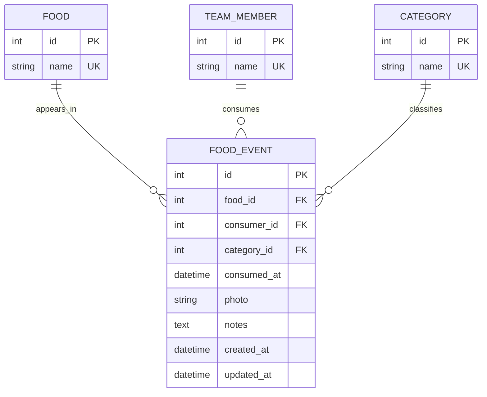

# Food tracker data model

## Entity relationship diagram

## Why these tables

- **Food** stores each food name once. An event points to a food instead of repeating its name, so spelling or renaming can be managed centrally.
- **TeamMember** stores each person once. Many events can refer to the same person.
- **Category** stores labels such as Lunch, Dinner, Snack, and Dairy once. Categories can be renamed without updating every event.
- **FoodEvent** records who ate which food, its category, and when. A photo and notes belong to the event because they describe that particular meal.

The three event foreign keys use `PROTECT`: deleting a referenced food, person, or category cannot silently erase or orphan the team's event history. Unique names prevent duplicate lookup rows. Indexes on event date and its combinations with category/person support the home page and common filters.

## Database backend

For quick local work, the project uses SQLite by default. To use the PostgreSQL backend required by Part 2, set `DATABASE_ENGINE=postgresql` and the `DB_NAME`, `DB_USER`, `DB_PASSWORD`, `DB_HOST`, and `DB_PORT` environment variables before running migrations. The PostgreSQL driver is included in `requirements.txt`; setup instructions are in the project README.
